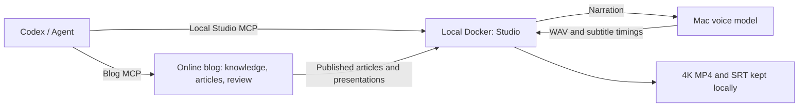

<p align="center">
  
</p>

<h1 align="center">Galley</h1>

<p align="center">Maintain knowledge, publish with your agent, and turn articles into narrated 4K videos on your own computer.</p>

<p align="center">
  <a href="https://github.com/codexiaoke/galley/actions/workflows/image.yml"></a>
  <a href="LICENSE"></a>
  <a href="https://github.com/codexiaoke/galley/pkgs/container/galley"></a>
</p>

<p align="center">
  <b>English</b> · <a href="README.zh-CN.md">简体中文</a>
</p>

---

**From knowledge and articles to presentations and video, in one project.**

Galley is a blog with an [MCP](https://modelcontextprotocol.io) endpoint. Add that endpoint to Claude
Code, Codex, or any other MCP client you already use, and the agent can read what the site knows, draft
an article and submit it. By default, you open the admin, read the draft, and approve it or send it back.
You can also grant an agent permission to publish directly. That permission is per agent, off by
default and revocable at any time.
Anything published that way is marked as unreviewed in the admin.

Published articles also become slide decks or projects in **Studio**, the local video workshop. Edit
versioned narration, direct attention with focus and zoom, generate speech, review a sample, and export
native 4K MP4 with subtitles. Editing Studio narration does not rewrite the published article.

The blog needs no writing-model API key: writing comes from the agent you connect. Speech generation
uses a separately configured TTS service. The setup verified so far uses a local MLX model and an
existing personal voice on a Mac.

## What runs where

| Component | Location | Responsibilities | Deployment entry |
|---|---|---|---|
| Galley blog | Server Docker; local source for development | Public articles, knowledge, review, presentations and blog MCP | [`./deploy.sh`](deploy.sh) |
| Video workshop Studio | **Docker on your own computer** | Narration versions, voice assets, review, 4K rendering and exports | [`pnpm studio:docker up`](integrations/video-studio/docker.ts) |
| Voice service | **Your Mac host** | Generate WAV and subtitle timings with the local model | Connected by the Studio script to your existing TTS MCP |
| Codex / another agent | Your client | Connect separately to the blog and Studio | [Connect an agent](#connect-an-agent) |

The blog and Studio have separate data and Agent keys. **Studio stays local; it is not deployed to the
public blog server.** Its default address is `http://localhost:4321`, published only on loopback. The
server supplies articles and presentation resources; your computer does the voice and video work.
You can use the blog without installing Studio or a voice model.



<p align="center">
  
</p>

## Why it is built this way

- **Articles are assembled from knowledge, not typed once and forgotten.** Facts, concepts, code, data,
  and your own opinions and experiences live as *knowledge blocks*. An article is written in its own
  words and marks which passage rests on which block.
- **Change a block and every article that leans on it gets fixed.** Updating a block finds every passage
  citing it, asks the agent to rewrite those passages, and collects the result into one card for you.
- **Publishing is enforced by the program, not by the agent's good behaviour.** The MCP surface has no
  publish tool until you grant one agent that permission explicitly, and never an unpublish or
  permission-changing one. The default is that approval is the only way in.
- **Writing is not tied to a model vendor.** Skills are served over MCP, so a connected agent can learn
  the site's workflow. Speech generation is configured separately.
- **Your data stays a file.** SQLite plus an images folder. Back it up by downloading one archive.

## How it works

**1. Connect the agent you already use.** Add an agent on the admin's MCP page, which hands you an access
key and a ready-made config snippet, and paste it into Claude Code, Codex or whatever else speaks MCP.
One-time setup.

**2. Tell it to write.** In your usual chat: *"Write a post about why SQLite is enough for a personal
site."* The agent reads the site's skills to learn the house rules, searches what the blog already knows,
writes the article in Galley's markup, and submits it for review. Nothing is live yet.

**3. Read it and decide.** The admin shows a rendered preview, a word-level diff against what is online,
and lets you comment on any sentence. **Approve** and it goes live; **send it back** with notes and the
agent revises.

**4. It keeps the facts honest.** Articles cite knowledge blocks rather than repeating facts inline. When
a block changes later, every article resting on it comes back as a revision task instead of quietly
rotting.

Want it to run on its own? There is an inbox you can drop thoughts and links into, a topic pool, and a
to-do list the agent reads on a schedule — so a nightly run has something to do without you asking. That
part is optional; day to day, talking to your agent is the whole workflow.

**5. Make a video locally.** Import a published article into Studio → edit narration and focus targets →
review the script → generate voices → preview and export a 4K sample → review the video → download the
final MP4 and SRT. Agents can prepare, revise and render assigned projects. Owners can separately grant
direct script confirmation and finalization; these actions are marked as not human-reviewed. Finalizing
a video does not publish an article or upload to a video platform.

<p align="center">
  
</p>

## What you get

**Writing and knowledge**

- Six kinds of knowledge block (fact, concept, code, data, opinion, experience), full-text search,
  near-duplicate detection, source links, staleness tracking, version-pinned citations.
- Change sets with inline review comments, rejection rounds, and an audit trail of every decision.
- Separate blog and Studio MCP tools, per-agent access keys, call logs and switches for optional tools.
- Agents can upload their own images, within limits: bytes only (never a URL to fetch), format checked by
  content, and a cap on how many unused images one agent may leave behind.
- Skills served on demand for overview, writing, markup, knowledge blocks, materials and video
  production, with version history for owner edits.

**Articles that do more than hold text**

- Content components include callouts, charts, timelines, pull quotes, stat tiles, step-by-step code, flow diagrams,
  tabs, before/after comparisons, collapsible sections, quizzes, and more.
- Code blocks with syntax highlighting, filenames and highlighted lines; a table of contents; footnotes;
  image lightboxes; LaTeX via KaTeX; Mermaid diagrams validated at save time.
- **Built-in algorithm animations** (sorting, search, mazes, graphs, trees, dynamic programming) that
  readers can play, step through and scrub, with switchable inputs and side-by-side races.
- **Code-driven animations**: write JavaScript in the article, run it in a QuickJS sandbox on the server,
  and the animation follows what the code actually did.
- **Runnable code blocks**: readers press Run and the code executes in a sandboxed worker in their own
  browser — no network, no DOM, with time and memory limits.

<p align="center">
  
</p>

**Presentations and local video production**

- [Studio](integrations/video-studio/README.md) keeps narration versions, voice assets, review comments
  and historical exports. Unchanged narration reuses its audio.
- Tie narration phrases to visual targets: corner markers, dimmed surroundings, or a gentle zoom.
  Captions stay fixed; preview and export share the same effects.
- Local Chromium renders frames on a controlled timeline and FFmpeg creates **3840×2160, 30 fps,
  H.264/AAC MP4**, plus SRT. No screen sharing is needed and window size does not affect output
  resolution. Raster images still depend on the resolution of their source assets.
- Any article turns into a full-screen slide deck: arrow keys step through code animations before turning
  the page, with speaker notes, autoplay and adjustable speed.
- The presentation page also offers browser tab recording with orientation, captions and microphone
  options. Use Studio's offline export for consistent 4K output.
- Export the deck to PDF, one slide per page.
- `/posts/<slug>/present.json` hands the slide breakdown to other programs — index, title and the
  page's own Markdown. Speaker notes are deliberately left out: they are not shown to readers.

<p align="center">
  
</p>

**For readers**

- Three built-in themes (Book, Plain, Engineer), each with a dark variant, switched from the admin.
- Terms defined in the knowledge base get a hover definition the first time they appear.
- Related posts at the end of each article, ranked by the concepts two articles share and labelled
  with which ones.
- A site-wide knowledge graph, public revision history per article, series with previous/next links,
  share card images rendered server-side, RSS, sitemap, structured data, and full-text search.
- Visitor stats with no cookies and no third party: the visitor mark is salted per day and cannot be
  traced back after midnight.

**Running the site**

- Daily automatic backups kept on the server, plus a one-click full archive and restore.
- Email notification when something is waiting for you (standard SMTP, no provider lock-in).
- A guest book, an operations log you can make public, and reader analytics the agent can read to pick
  better topics.

## Quick start

### Deploy the online blog

You need Docker on the server. Nothing else.

```bash
git clone https://github.com/codexiaoke/galley.git && cd galley
```

```bash
./deploy.sh
```

The script asks for a port, an optional domain, and an admin password, writes them to `.env`, pulls the
image, starts it and waits until it is healthy. Give it a domain and it also runs Caddy for automatic
HTTPS. Images are built by GitHub Actions for both x86 and ARM, so the server only downloads — a 2-core
box is plenty.

See [docs/deployment.md](docs/deployment.md) for offline installs, building on your own machine and
shipping to the server, environment variables and day-to-day commands.

### Deploy Studio on your computer

On **your Mac**, prepare Docker Desktop / OrbStack, Node.js 22, pnpm and a
[configured voice service](integrations/video-studio/voice-setup.md). In a local clone of this repository:

```bash
pnpm install --frozen-lockfile
pnpm studio:docker up
pnpm studio:docker open
```

The deployment script is [`integrations/video-studio/docker.ts`](integrations/video-studio/docker.ts).
It builds the separate Studio image, configures the host voice connection, starts the container and
waits for its health check. `open` signs you into the workshop without copying an owner key manually.
Automatic host voice setup currently targets macOS. Without a voice service, you can first start the
management and preview UI with `docker compose -f compose.studio.yml up -d --build`;
see the [Studio deployment guide](integrations/video-studio/README.md) for login and manual setup.

In Studio settings, enter the root URL of your **existing blog**, such as `https://blog.example.com`,
and an access key created in that blog's MCP admin page. Test and save the connection. You do not need
a second blog container or a copy of the online database.

```bash
pnpm studio:docker status # Inspect running services
pnpm studio:docker logs   # Follow container logs
pnpm studio:docker stop   # Stop while retaining projects and exports
pnpm studio:docker up     # Rebuild after updating the checkout and dependencies
```

Studio data lives in the `galley-studio_studio-data` volume. Migrate the **complete** work directory if
you already use the source-run workshop, including audio, exports and hidden keys. Deployment,
migration, ports and backups are covered in the [Studio guide](integrations/video-studio/README.md).

### Develop the blog locally

Node.js 22 and pnpm.

```bash
pnpm install && cp .env.example .env.local
```

Set `GALLEY_ADMIN_PASSWORD` (8 characters or more) in `.env.local`, then:

```bash
pnpm dev
```

The site is on [http://localhost:3000](http://localhost:3000), the admin on `/admin`, the MCP endpoint on `/mcp`. Run
`pnpm seed:demo` if you want a few example articles to look at.

## Using narration and voices

This repository supplies the voice connection and production workflow. **It does not include model
weights, personal reference audio, or the separate `my-voice-tts` service**, and the deployment script
does not download them. Prepare a stdio MCP server with `generate_voiceover` and `unload_voice_model`.
Studio can read its entry in `~/.claude.json`, or use `STUDIO_TTS_COMMAND` directly; a Claude client is
not required. See [voice setup and the service contract](integrations/video-studio/voice-setup.md).

1. Create a project and edit each beat's narration. Empty narration uses a hold duration with no speech.
2. Review the script, then generate voices. Studio saves WAV files and subtitle timings for each beat;
   preview individual voices and regenerate changed beats.
3. Add focus targets, preview the timing, then export a 4K sample. Focus-only edits reuse the audio.
4. Review the sample and download MP4/SRT. Release model memory in Studio settings when finished;
   the voice service loads the model again on the next request.

Voice identity, reference audio, speed and model parameters belong to the voice service. Studio does
not train voices or assign separate character voices. When changing a voice under the same service
name, explicitly regenerate affected beats to replace cached audio.

## Connect an agent

### Blog: writing and publishing

Any MCP client works — Claude Code and Codex are the two this is tested against. Add an agent on the
admin's **MCP** page: it shows an access key once, along with a config snippet already filled in with
your site's address. Or from the command line:

```bash
pnpm agent:create Codex
```

Put the key in `GALLEY_TOKEN`. In **Codex**, add to `~/.codex/config.toml`:

```toml
[mcp_servers.galley]
url = "https://your-site/mcp"
bearer_token_env_var = "GALLEY_TOKEN"
default_tools_approval_mode = "approve"
```

In **Claude Code**, add to `~/.claude.json`:

```json
{ "mcpServers": { "galley": { "type": "http", "url": "https://your-site/mcp",
  "headers": { "Authorization": "Bearer YOUR_TOKEN" } } } }
```

Then just talk to it: *"Have a look at my blog and suggest three posts I could write."* On its first call
the agent is pointed at the site's `overview` skill, which tells it how this blog is run — you do not
have to explain anything.

The last Codex setting controls client-side tool confirmation. The blog independently checks Agent
permissions: by default an agent submits for review. Owners can grant direct publication of that
agent's change sets. An agent cannot change its own permissions, approve other authors' work,
unpublish content or read the guest book.

There is also a plugin that skips the manual setup: download one pre-filled with your site's address from
the admin, or use the generic one in [integrations/codex](integrations/codex).

### Local Studio: narration, voices and video

Create a separate key in Studio's Agent management and assign a project to that agent. Make the key
available to the client as `STUDIO_AGENT_TOKEN`, then connect:

```bash
codex mcp add galley-studio --url http://localhost:4321/mcp --bearer-token-env-var STUDIO_AGENT_TOKEN
```

The Codex process must be able to read that environment variable. Blog keys do not replace Studio
Agent keys; do not give an agent the owner login key. The plugin's `galley-studio` skill guides the
workflow but **does not deploy Studio or connect its MCP endpoint automatically**. After connecting,
call `studio_get_skill` to read the current production instructions.

For example: *"Inspect my assigned video project, revise the narration and focus targets, and submit
for review. Once approved, generate voices and a 4K sample."* Blog publishing and Studio finalization
are separate permissions; finalized video files remain local.

## Documentation

| Document | What is in it |
|---|---|
| [docs/requirements.md](docs/requirements.md) | What the product is and every feature's current state |
| [docs/design-knowledge-blocks.md](docs/design-knowledge-blocks.md) | Knowledge blocks, citations and change sets |
| [docs/deployment.md](docs/deployment.md) | Online blog deployment, HTTPS, updates and environment variables |
| [Studio guide](integrations/video-studio/README.md) | Local Docker, migration, project review, 4K exports and backups |
| [Voice setup](integrations/video-studio/voice-setup.md) | Local voice service, MCP configuration, regeneration and troubleshooting |
| [Codex plugin](integrations/codex/README.md) | Installing the plugin and connecting the two MCP services |
| [AGENTS.md](AGENTS.md) | Conventions for anyone — human or agent — writing code here |

The design and detailed Studio guides are written in Chinese.

## Project layout

| Path | What lives there |
|---|---|
| `src/core` | Data model, markup, and every business rule. No Next.js imports |
| `src/mcp` | The MCP server; each tool is a thin shell over core |
| `src/app` | Public site, admin, and the MCP endpoint |
| `src/render` | Turning article markup into pages |
| `skills` | Skills served to agents |
| `drizzle` | Database migrations |
| `integrations/video-studio` | Local workshop, Docker deployment entry, voice connection and offline renderer |
| `integrations/codex` | Codex plugin and entry skills |
| `docker-compose.yml` / `deploy.sh` | Online blog deployment |
| `compose.studio.yml` | Local Studio deployment |

Permission rules live only in `src/core`. The admin and MCP call the same functions and pass a different
identity, so there is one place where "who may do what" is decided.

## Contributing

Issues and pull requests are welcome — see [CONTRIBUTING.md](CONTRIBUTING.md). Galley is a personal-scale
project by design. There is no blog runtime plugin system or theme marketplace; the bundled Codex
plugin is for the Agent client. Fork the project when you need to customize the product.

| Command | What it does |
|---|---|
| `pnpm dev` | Start the dev server |
| `pnpm test` | Run the tests |
| `pnpm typecheck` | Type check |
| `pnpm lint` | Lint |
| `pnpm build` | Production build |
| `pnpm db:generate` | Generate a migration after changing the schema |
| `pnpm studio:docker help` | Show local Studio deployment commands |
| `pnpm studio` / `pnpm studio:open` | Run Studio from source / open the owner UI |
| `pnpm studio:tts` | Run the host voice connection in the foreground for manual setup and diagnostics |

## License

[MIT](LICENSE)
