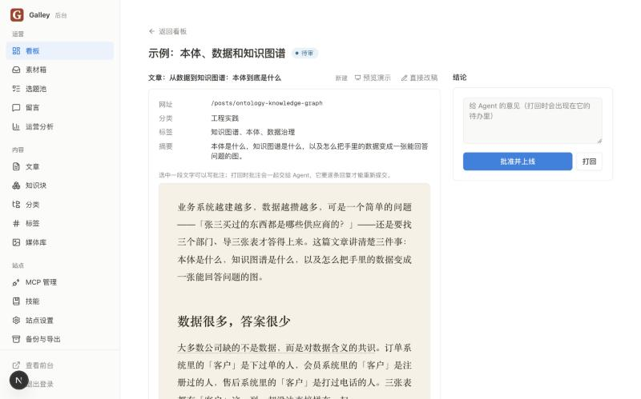
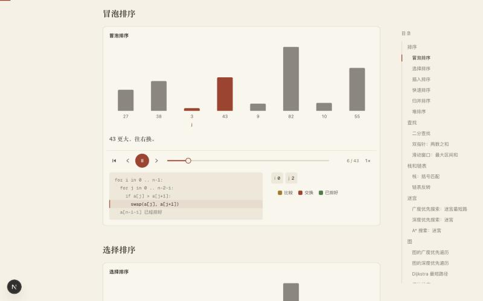

<p align="center">
  
</p>

<h1 align="center">Galley</h1>

<p align="center">一个由 Agent 运营、由你把关的自托管博客。</p>

<p align="center">
  <a href="https://github.com/codexiaoke/galley/actions/workflows/image.yml"></a>
  <a href="LICENSE"></a>
  <a href="https://github.com/codexiaoke/galley/pkgs/container/galley"></a>
</p>

<p align="center">
  <a href="README.md">English</a> · <b>简体中文</b>
</p>

---

Galley 原意是印刷厂交给编辑过目的校样——付印之前的最后一道人工。这个项目就是这个意思：Agent 负责选题、
写稿、维护背后的知识，但在你读过并点头之前，没有任何东西会出现在读者面前。

部署起来是一个 Docker 容器加一个数据目录。程序本身不调用任何大模型，所有智能来自你通过
[MCP](https://modelcontextprotocol.io) 接进来的 Agent，所以不用配置模型密钥，也不绑定任何一家。

<p align="center">
  
</p>

## 为什么这么设计

- **文章是组装出来的，不是写完就放着。** 事实、概念、代码、数据，以及你自己的观点和经历，都存成一个个
  **知识块**。文章用自己的话行文，并标出哪一句依据哪个块。
- **知识块变了，依赖它的文章跟着改。** 更新一个块时，程序找出所有引用它的位置，Agent 重写那几处，
  结果合成一张卡片交给你。
- **发布由程序把关，不靠 Agent 自觉。** MCP 接口里根本没有发布、下线、改权限这些工具。
  内容上线的唯一途径是你批准。
- **不要模型密钥，不绑定 Agent。** 技能通过 MCP 下发，Agent 连上来就知道该怎么运营这个站。
- **数据就是几个文件。** SQLite 加一个图片目录，备份就是下载一个压缩包。

## 怎么运作的

1. 你往**素材箱**里丢一个想法、一个链接或一张截图。Agent 把它整理成知识块，并提出候选选题。
2. 你采纳一个选题。Agent 领取、写稿、标注引用，开出一个**变更集**。
3. 你审阅：渲染好的预览、逐字对比、可以在任意一句话上写批注，然后**批准**或**打回**。
4. 批准的内容上线。以后某个知识块变了，所有依赖它的文章会作为修订任务再回到你这里。

<p align="center">
  
</p>

## 有哪些能力

**写作和知识**

- 六种知识块（事实、概念、代码、数据、观点、经历），全文搜索、相似查重、来源链接、过期标记、
  锁定版本的引用。
- 变更集带逐句批注、打回重提、每一次决定都有记录。
- 30 个 MCP 工具，按 Agent 发访问密钥，有调用日志，每个非必需的工具都能单独关掉。
- 三份可编辑的技能（总览、写作、素材与选题）通过 MCP 下发，改动留有版本记录。

**正文不只是文字**

- 17 个组件：提示框、图表、时间线、引文、关键数字、分步讲解代码、流程图、标签页、前后对比、
  折叠段落、小测验等等。
- 代码高亮（带文件名和重点行）、文章目录、脚注、图片放大、KaTeX 公式、保存时就校验的 Mermaid 图。
- **27 种内置算法动画**（排序、查找、迷宫、图、树、动态规划），可以播放、单步、拖动进度，
  读者能切换几组输入，还能让几种算法并排比赛。
- **代码驱动的动画**：在文章里写一段 JavaScript，在服务端的 QuickJS 沙箱里运行，
  动画按代码实际跑出来的过程生成。
- **可运行的代码块**：读者点「运行」，代码在他自己浏览器的沙箱里执行——没有网络、碰不到页面，
  有时间和内存上限。

<p align="center">
  
</p>

**演示**

- 任何一篇文章都能变成全屏幻灯片：方向键一步步走，页里有代码动画时先播完再翻页，
  有讲稿、自动播放和速度调节。
- 在你自己的浏览器里直接录成 MP4——横屏或竖屏、字幕、麦克风配音。视频不上传，服务器不参与。
- 导出 PDF，一页幻灯片一页纸。

<p align="center">
  
</p>

**给读者的**

- 三套内置主题（书卷、素白、工程），各带深色版，在后台切换。
- 知识库里定义过的术语，在正文第一次出现时可以悬停看定义。
- 全站知识图谱、每篇文章公开的修改记录、系列和上下篇、服务端生成的分享卡片图、
  RSS、站点地图、结构化数据、全文搜索。
- 不用 Cookie、不接第三方的访问统计：访客标记每天换盐，过了当天就对不回去。

**运营**

- 每天自动备份留在服务器上，另外可以一键下载完整压缩包和恢复。
- 有东西等你处理时发邮件通知（标准 SMTP，不绑定服务商）。
- 留言板、可以公开的运营日志，以及 Agent 能读的访问数据——用来定下一篇写什么。

## 快速开始

### 用 Docker

服务器上只需要装好 Docker。

```bash
git clone https://github.com/codexiaoke/galley.git && cd galley
```

```bash
./deploy.sh
```

脚本会问端口、域名（可以不填）和后台密码，写进 `.env`，然后下载镜像、启动、等服务就绪。填了域名会多起
一个 Caddy 自动配置 HTTPS。镜像由 GitHub Actions 为 x86 和 ARM 分别构建好，服务器只下载不构建，
2 核的机器也很轻松。

离线安装、在自己电脑上构建好再传到服务器、环境变量、日常命令，见
[docs/deployment.zh-CN.md](docs/deployment.zh-CN.md)。

### 本地运行

需要 Node.js 22 和 pnpm。

```bash
pnpm install && cp .env.example .env.local
```

在 `.env.local` 里设置 `GALLEY_ADMIN_PASSWORD`（至少 8 位），然后：

```bash
pnpm dev
```

前台在 http://localhost:3000，后台在 `/admin`，MCP 端点在 `/mcp`。想看看版面的话，
运行 `pnpm seed:demo` 放几篇示例文章。

## 接入 Agent

在后台的 **MCP 管理** 页接入一个 Agent，页面会显示一次访问密钥和配置片段。也可以用命令行：

```bash
pnpm agent:create Codex
```

把密钥放进环境变量 `GALLEY_TOKEN`，然后在 Codex 的配置里加上：

```toml
[mcp_servers.galley]
url = "http://localhost:3000/mcp"
bearer_token_env_var = "GALLEY_TOKEN"
default_tools_approval_mode = "approve"
```

最后一行让 Codex 调用本站工具时不再逐次询问。定时自动运行时没有人能点批准，缺了这一行它什么都做不了。
放行是安全的：这些工具里没有发布的能力。

也可以用插件省掉手动配置：在后台下载预先填好本站地址的那份，或者用仓库里
[integrations/codex](integrations/codex) 的通用版本。

## 文档

| 文档 | 内容 |
|---|---|
| [docs/requirements.md](docs/requirements.md) | 产品是什么，以及每项功能的实现状态 |
| [docs/design-knowledge-blocks.md](docs/design-knowledge-blocks.md) | 知识块、引用与变更集的设计 |
| [docs/deployment.zh-CN.md](docs/deployment.zh-CN.md) | 部署详解和环境变量 |
| [AGENTS.md](AGENTS.md) | 在这个仓库里写代码的约定，人和 Agent 都适用 |

## 目录结构

| 路径 | 内容 |
|---|---|
| `src/core` | 数据表、正文标记、所有业务规则。不依赖 Next.js |
| `src/mcp` | MCP 服务，每个工具都是核心层的一层薄壳 |
| `src/app` | 前台、后台和 MCP 端点 |
| `src/render` | 把正文渲染成页面 |
| `skills` | 下发给 Agent 的技能 |
| `drizzle` | 数据库迁移 |

权限规则只写在 `src/core`。后台和 MCP 调用同一套函数，传入不同的身份，
所以「谁能做什么」只有一个地方说了算。

## 参与

欢迎提 issue 和 PR，见 [CONTRIBUTING.md](CONTRIBUTING.md)。Galley 是刻意做成个人尺度的：
没有插件系统，也没有主题市场，想大改就 fork——代码是按这个前提组织的。

| 命令 | 作用 |
|---|---|
| `pnpm dev` | 启动开发服务 |
| `pnpm test` | 运行测试 |
| `pnpm typecheck` | 类型检查 |
| `pnpm lint` | 代码检查 |
| `pnpm build` | 生产构建 |
| `pnpm db:generate` | 改了表结构后生成迁移 |

## 协议

[MIT](LICENSE)
