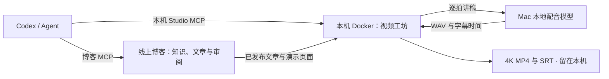

<p align="center">
  
</p>

<h1 align="center">Galley</h1>

<p align="center">用 Agent 维护知识、写博客，再在本机把文章做成有配音的 4K 视频。</p>

<p align="center">
  <a href="https://github.com/codexiaoke/galley/actions/workflows/image.yml"></a>
  <a href="LICENSE"></a>
  <a href="https://github.com/codexiaoke/galley/pkgs/container/galley"></a>
</p>

<p align="center">
  <a href="README.md">English</a> · <b>简体中文</b>
</p>

---

**从知识和文章，到演示和视频，在同一个项目里完成。**

Galley 是一个带 [MCP](https://modelcontextprotocol.io) 端点的博客。把这个端点加进 Claude Code、Codex，
或者你本来就在用的任何 MCP 客户端，Agent 就能读到这个站已有的东西、写出文章、提交审阅。
你打开后台读一遍，批准或者打回。默认就是这样：Agent 写，你点头才上线。
站长也可以在后台对某个 Agent 单独开启「直接上线」。权限默认关闭、随时可收回，
这样上线的内容会标出「没经过审阅」。

已发布的文章可以直接演示，也可以导入本机的 **视频工坊 Studio**：编辑逐拍讲稿、安排重点聚焦、生成配音，
审查后导出原生 4K MP4 和字幕。工坊讲稿有自己的版本，不会反过来改写线上文章。

博客本身不需要配置写作模型，内容创作由你接入的 Agent 完成。视频配音使用另行配置的 TTS 服务；
当前已验证的是 Mac 上的本地 MLX 配音，沿用已有模型和个人声线。

## 哪部分放在哪里

| 部分 | 运行位置 | 负责什么 | 部署入口 |
|---|---|---|---|
| Galley 博客 | 服务器 Docker，也可本机开发 | 公开文章、知识块、后台审阅、演示页、博客 MCP | [`./deploy.sh`](deploy.sh) |
| 视频工坊 Studio | **你的电脑上的 Docker** | 讲稿版本、配音管理、审查、4K 渲染、成片与字幕 | [`pnpm studio:docker up`](integrations/video-studio/docker.ts) |
| 配音服务 | **你的 Mac 宿主机** | 调用本地模型生成 WAV 与字幕时间，再传给工坊 | 由工坊部署脚本连接已有 TTS MCP |
| Codex / 其他 Agent | 你使用的客户端 | 分别连接博客和工坊，按权限完成写作与制作 | [Agent 接入](#接入-agent) |

博客和工坊是两个独立服务、两份数据和两组 Agent 密钥。**视频工坊不部署到博客的公网服务器**；
默认只开放本机 `http://localhost:4321`。线上服务器提供文章与演示资源，本机承担配音和视频计算。
只写博客时不必安装工坊或配音服务。



<p align="center">
  
</p>

## 为什么这么设计

- **文章是组装出来的，不是写完就放着。** 事实、概念、代码、数据，以及你自己的观点和经历，都存成一个个
  **知识块**。文章用自己的话行文，并标出哪一句依据哪个块。
- **知识块变了，依赖它的文章跟着改。** 更新一个块时，程序找出所有引用它的位置，Agent 重写那几处，
  结果合成一张卡片交给你。
- **发布权限由程序管，不靠 Agent 自觉。** 默认任何 Agent 都不能让内容上线，只能提交审阅；要放开，得你在后台对某一个 Agent 明确打开，而且随时能收回。下线、读留言、改自己的权限始终不开放。
- **写作不绑定模型厂商。** 技能通过 MCP 下发，Agent 连上来就知道该怎么运营这个站；视频配音单独接入。
- **数据就是几个文件。** SQLite 加一个图片目录，备份就是下载一个压缩包。

## 怎么运作的

**1. 把你在用的 Agent 接上来。** 在后台的 MCP 页加一个 Agent，它会给你一个访问密钥和一段填好地址的配置，
粘进 Claude Code、Codex 或者别的支持 MCP 的客户端。只配一次。

**2. 直接让它写。** 在你平时聊天的地方说一句：*「写一篇关于个人站点用 SQLite 就够了的文章。」*
Agent 会先读这个站的技能，知道这里的规矩，再搜一遍博客已有的内容，用 Galley 的标记写出来，提交审阅。
这时候还没上线。

**3. 你读一遍，决定。** 后台给你渲染好的预览、和线上版本的逐字对比，任意一句话都能写批注。
**批准**就上线，**打回**并写上意见，Agent 照着改。

**4. 它会替你盯住事实。** 文章引用知识块，而不是把事实抄进正文。以后某个知识块变了，
所有依赖它的文章会作为修订任务回到你这里，不会悄悄过期。

想让它自己跑？站里有素材箱（丢想法和链接）、选题池和一份待办清单，Agent 定时跑的时候照着做，
不用你开口。这部分是可选的——日常用起来，跟你的 Agent 说句话就是全部流程。

**5. 把文章做成视频。** 本机工坊导入已发布文章 → 修改讲稿与聚焦目标 → 讲稿审查 → 生成配音 →
预览并导出 4K 样片 → 成片审查 → 下载定稿与字幕。Agent 可以准备讲稿、回复批注和执行制作，
站长也可单独授权它直接确认讲稿与定稿；这类操作会标明未经人工审阅。定稿不会自动发布文章或上传视频平台。

<p align="center">
  
</p>

## 有哪些能力

**写作和知识**

- 六种知识块（事实、概念、代码、数据、观点、经历），全文搜索、相似查重、来源链接、过期标记、
  锁定版本的引用。
- 变更集带逐句批注、打回重提、每一次决定都有记录。
- 博客和工坊分别提供 MCP 工具，按 Agent 发访问密钥，有调用日志，每个非必需的工具都能单独关掉。
- Agent 可以传自己做的图，但口子很窄：只收图片字节不收网址，按文件内容认格式，传了没用上的攒够十张就不让再传。
- 技能通过 MCP 按需下发，覆盖总览、写作、正文标记、知识块、素材与选题、视频制作；站长修改技能有版本记录。

**正文不只是文字**

- 正文组件包括提示框、图表、时间线、引文、关键数字、分步讲解代码、流程图、标签页、前后对比、
  折叠段落、小测验等等。
- 代码高亮（带文件名和重点行）、文章目录、脚注、图片放大、KaTeX 公式、保存时就校验的 Mermaid 图。
- **内置算法动画**涵盖排序、查找、迷宫、图、树、动态规划，可以播放、单步、拖动进度，
  读者能切换几组输入，还能让几种算法并排比赛。
- **代码驱动的动画**：在文章里写一段 JavaScript，在服务端的 QuickJS 沙箱里运行，
  动画按代码实际跑出来的过程生成。
- **可运行的代码块**：读者点「运行」，代码在他自己浏览器的沙箱里执行——没有网络、碰不到页面，
  有时间和内存上限。

<p align="center">
  
</p>

**演示与本机视频制作**

- [视频工坊 Studio](integrations/video-studio/README.md) 管理独立讲稿版本、逐拍配音、审查批注和历史成片；未改文字的配音可复用。
- 按讲稿原话绑定画面元素，支持四角框指示、周围弱化和放大聚焦；字幕保持原位，预览与导出使用同一套效果。
- 本机 Chromium 按固定时间逐帧渲染，FFmpeg 合成 **3840×2160、30 fps、H.264/AAC MP4**，同时导出 SRT。
  不需要共享屏幕，窗口尺寸不影响输出分辨率；位图仍受原素材清晰度限制。
- 任何一篇文章都能变成全屏幻灯片：方向键一步步走，页里有代码动画时先播完再翻页，
  有讲稿、自动播放和速度调节。
- 演示页也保留浏览器标签页录制，支持横竖屏、字幕和麦克风；需要稳定 4K 成片时使用工坊的离线导出。
- 导出 PDF，一页幻灯片一页纸。
- `/posts/<别名>/present.json` 把拆页的结果交给别的程序：序号、标题和这一页的 Markdown。刻意不含讲稿——那是演讲时自己看的提词，页面上也不给读者看。

<p align="center">
  
</p>

**给读者的**

- 三套内置主题（书卷、素白、工程），各带深色版，在后台切换。
- 知识库里定义过的术语，在正文第一次出现时可以悬停看定义。
- 文章末尾的相关文章，按两篇共同讲到的概念排序，并写明共同讲到了什么。
- 全站知识图谱、每篇文章公开的修改记录、系列和上下篇、服务端生成的分享卡片图、
  RSS、站点地图、结构化数据、全文搜索。
- 不用 Cookie、不接第三方的访问统计：访客标记每天换盐，过了当天就对不回去。

**运营**

- 每天自动备份留在服务器上，另外可以一键下载完整压缩包和恢复。
- 有东西等你处理时发邮件通知（标准 SMTP，不绑定服务商）。
- 留言板、可以公开的运营日志，以及 Agent 能读的访问数据——用来定下一篇写什么。

## 快速开始

### 部署线上博客

服务器上只需要装好 Docker。

```bash
git clone https://github.com/codexiaoke/galley.git && cd galley
```

```bash
./deploy.sh
```

脚本会问端口、域名（可以不填）和后台密码，写进 `.env`，然后下载镜像、启动、等服务就绪。填了域名会多起
一个 Caddy 自动配置 HTTPS。镜像由 GitHub Actions 为 x86 和 ARM 分别构建好，服务器只下载不构建，
2 核的机器也很轻松。

离线安装、在自己电脑上构建好再传到服务器、环境变量、日常命令，见
[docs/deployment.zh-CN.md](docs/deployment.zh-CN.md)。

### 部署本机视频工坊

在**自己的 Mac** 上准备 Docker Desktop / OrbStack、Node.js 22、pnpm，以及[已配置的配音服务](integrations/video-studio/voice-setup.md)。
克隆本仓库后，在根目录运行：

```bash
pnpm install --frozen-lockfile
pnpm studio:docker up
pnpm studio:docker open
```

部署脚本在 [`integrations/video-studio/docker.ts`](integrations/video-studio/docker.ts)。它构建独立工坊镜像、
配置宿主机配音连接、启动容器并等待健康检查；`open` 自动登录，不需要手工复制管理密钥。
当前自动配置配音的脚本面向 macOS。还没准备配音时，可按[工坊手动部署说明](integrations/video-studio/README.md#手动运行容器)先启动管理与预览界面。

打开工坊后，在「工坊设置 → 配置站点」填写**已有博客的根地址**（例如 `https://blog.example.com`），
以及博客后台创建的访问密钥，测试并保存。工坊无需再起一个博客容器，也不需要复制线上数据库。

```bash
pnpm studio:docker status # 查看运行状态
pnpm studio:docker logs   # 查看日志
pnpm studio:docker stop   # 停止，保留项目与成片
pnpm studio:docker up     # 更新仓库和依赖后重新构建、启动
```

工坊数据保存在 `galley-studio_studio-data` 卷中。源码运行的旧工坊须[迁移完整工作目录](integrations/video-studio/README.md#迁移已有工坊)，
不能只拷贝数据库。详细的更新、端口、备份和恢复说明见[工坊文档](integrations/video-studio/README.md)。

### 本地开发博客

需要 Node.js 22 和 pnpm。

```bash
pnpm install && cp .env.example .env.local
```

在 `.env.local` 里设置 `GALLEY_ADMIN_PASSWORD`（至少 8 位），然后：

```bash
pnpm dev
```

前台在 [http://localhost:3000](http://localhost:3000)，后台在 `/admin`，MCP 端点在 `/mcp`。想看看版面的话，
运行 `pnpm seed:demo` 放几篇示例文章。

## 配音怎么用

仓库提供配音连接与制作流程，**不包含 TTS 模型、个人参考音频或独立的 `my-voice-tts` 服务**，部署脚本也不会下载它们。
先准备能提供 `generate_voiceover` 与 `unload_voice_model` 的 stdio MCP 服务，再按[配音配置与使用](integrations/video-studio/voice-setup.md)接入。
可以读取已有 `~/.claude.json` 中的配置，也可用 `STUDIO_TTS_COMMAND` 直接指定命令，不要求安装 Claude 客户端。

配好后，在工坊中按以下顺序使用：

1. 新建项目并修改逐拍讲稿。空讲稿的拍点按停留时长播放，不生成声音。
2. 提交讲稿审查，通过后生成配音。每拍保存 WAV 和字幕时间，支持试听；修改文字后，只重新生成变化的拍点。
3. 添加需要强调的聚焦目标，预览声音、画面与字幕，再导出 4K 样片。只修改聚焦效果时复用原配音。
4. 审查样片后下载 MP4 与 SRT；用完可在「工坊设置」释放模型内存，下次配音会重新加载。

个人声线、参考音频、语速和模型参数由配音服务配置；Studio 不训练声线，也不做分角色配音。
更换同名配音服务的声线后，对需要更新的拍点执行重新配音，避免继续复用旧缓存。

## 接入 Agent

### 博客：写作与发布

任何支持 MCP 的客户端都行，Claude Code 和 Codex 是实际验证过的两个。在后台的 **MCP 管理** 页加一个
Agent，页面会显示一次访问密钥，以及一段已经填好本站地址的配置。也可以用命令行：

```bash
pnpm agent:create Codex
```

把密钥放进环境变量 `GALLEY_TOKEN`。**Codex** 加进 `~/.codex/config.toml`：

```toml
[mcp_servers.galley]
url = "https://你的站点/mcp"
bearer_token_env_var = "GALLEY_TOKEN"
default_tools_approval_mode = "approve"
```

**Claude Code** 加进 `~/.claude.json`：

```json
{ "mcpServers": { "galley": { "type": "http", "url": "https://你的站点/mcp",
  "headers": { "Authorization": "Bearer 你的密钥" } } } }
```

然后直接跟它说话：*「看一下我的博客，提三个可以写的题目。」* Agent 第一次调用时会被引导去读站上的
`overview` 技能，那里写明了这个博客怎么运营，你不用再解释一遍。

Codex 配置里最后一行设置本站工具的调用确认方式；博客仍会独立检查 Agent 权限。
默认只能提交审阅。站长可以单独授权某个 Agent 直接发布自己的变更集；Agent 不能自行修改权限、批准别人的稿件、下线或读取留言。

也可以用插件省掉手动配置：在后台下载预先填好本站地址的那份，或者用仓库里
[integrations/codex](integrations/codex) 的通用版本。

### 本机工坊：讲稿、配音与成片

在工坊的「Agent 管理」创建独立密钥，并把项目分配给该 Agent。将密钥设为客户端环境变量 `STUDIO_AGENT_TOKEN`，然后接入：

```bash
codex mcp add galley-studio --url http://localhost:4321/mcp --bearer-token-env-var STUDIO_AGENT_TOKEN
```

Codex 进程需要能读取该环境变量。博客密钥不能替代工坊 Agent 密钥，站长管理密钥也不要交给 Agent。
插件的 `galley-studio` 技能负责引导制作，**不会自动部署工坊或连接它的 MCP**；连接后先用 `studio_get_skill` 读取当前要求。

例如：*「读取我分配的视频项目，检查讲稿和聚焦目标，把修改提交审查；通过后生成配音和 4K 样片。」*
工坊与博客的直接发布权限分别授权，成片定稿仍保留在本机。

## 文档

| 文档 | 内容 |
|---|---|
| [docs/requirements.md](docs/requirements.md) | 产品是什么，以及每项功能的实现状态 |
| [docs/design-knowledge-blocks.md](docs/design-knowledge-blocks.md) | 知识块、引用与变更集的设计 |
| [docs/deployment.zh-CN.md](docs/deployment.zh-CN.md) | 线上博客部署、HTTPS、升级和环境变量 |
| [视频工坊](integrations/video-studio/README.md) | 本机 Docker、迁移、项目审查、4K 导出与备份 |
| [配音配置与使用](integrations/video-studio/voice-setup.md) | 本地模型服务、MCP 配置、试听、重配和排错 |
| [Codex 插件](integrations/codex/README.md) | 安装插件与分别接入博客、工坊 |
| [AGENTS.md](AGENTS.md) | 在这个仓库里写代码的约定，人和 Agent 都适用 |

## 目录结构

| 路径 | 内容 |
|---|---|
| `src/core` | 数据表、正文标记、所有业务规则。不依赖 Next.js |
| `src/mcp` | MCP 服务，每个工具都是核心层的一层薄壳 |
| `src/app` | 前台、后台和 MCP 端点 |
| `src/render` | 把正文渲染成页面 |
| `skills` | 下发给 Agent 的技能 |
| `drizzle` | 数据库迁移 |
| `integrations/video-studio` | 本机工坊、Docker 部署入口、配音连接和离线渲染 |
| `integrations/codex` | Codex 插件与入口技能 |
| `docker-compose.yml` / `deploy.sh` | 线上博客部署 |
| `compose.studio.yml` | 本机工坊部署 |

权限规则只写在 `src/core`。后台和 MCP 调用同一套函数，传入不同的身份，
所以「谁能做什么」只有一个地方说了算。

## 参与

欢迎提 issue 和 PR，见 [CONTRIBUTING.md](CONTRIBUTING.md)。Galley 是刻意做成个人尺度的：
不提供博客运行时插件系统或主题市场；仓库附带的是 Agent 客户端的 Codex 插件。需要定制产品时可以 fork。

| 命令 | 作用 |
|---|---|
| `pnpm dev` | 启动开发服务 |
| `pnpm test` | 运行测试 |
| `pnpm typecheck` | 类型检查 |
| `pnpm lint` | 代码检查 |
| `pnpm build` | 生产构建 |
| `pnpm db:generate` | 改了表结构后生成迁移 |
| `pnpm studio:docker help` | 查看本机工坊部署命令 |
| `pnpm studio` / `pnpm studio:open` | 源码运行工坊 / 打开管理入口 |
| `pnpm studio:tts` | 前台运行宿主机配音连接，用于手动配置和排错 |

## 协议

[MIT](LICENSE)
